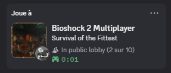
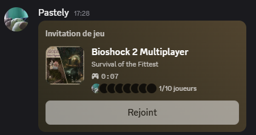

# BioRPC — Discord Rich Presence for BioShock 2 Multiplayer

Shows what you're playing on your Discord profile, and lets your friends join you.

 

## Install

**1. The plugin loader** — get `dxgi.dll` from the
[plugin loader](https://github.com/SnowTempest/Bioshock-2-Multiplayer-Plugins) if you
don't already have it.

**2. `BioRPC.dll`** — from the [latest release](../../releases/latest).

Close the game, then drop both files here:

```
steamapps/common/BioShock 2/
└── MP/
    └── Builds/
        └── Binaries/
            ├── Bioshock2.exe
            ├── dxgi.dll              <- the loader
            └── BioPlugins/
                ├── BioRPC.dll        <- the plugin
                ├── BioRPC.ini        <- optional, settings
                └── BioRPC.log        <- appears on its own, says what happened
```

Start the game with Discord open. That's it — nothing to install, no account to create,
no admin rights. **To remove it, delete `BioRPC.dll`.**

## Settings (optional)

Everything works without a settings file. Create `BioPlugins/BioRPC.ini` only if you
want to use your own Discord application instead of the shared one:

```ini
client_id = 1234567890
```

## Is it safe?

By default the plugin only reads. It never changes the game, never touches the network,
and never sends your name, your friends or your chat anywhere. The only thing leaving
your PC is the activity card, sent to your own Discord app.

If anything misbehaves, `BioPlugins/BioRPC.log` says why.

## Feedback

If the card gets something wrong, tell me — a screenshot and `BioPlugins/BioRPC.log` are
all I need.

## Licence

MIT, see [LICENSE](LICENSE) — the plugin is free to use and to share.

The source lives in a private repository for now. If you want to read it or build it
yourself, ask; I would rather hand it over than have anyone run a DLL they cannot check.

BioShock 2 and its artwork belong to 2K Games; none of it is in this repository.
